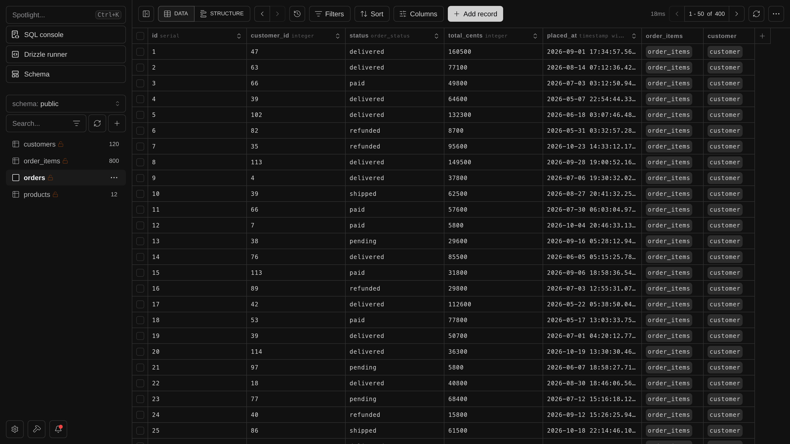
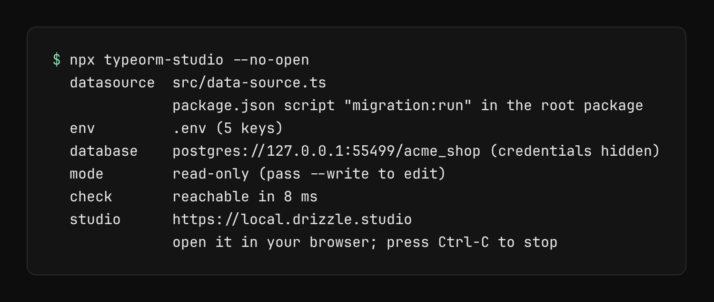
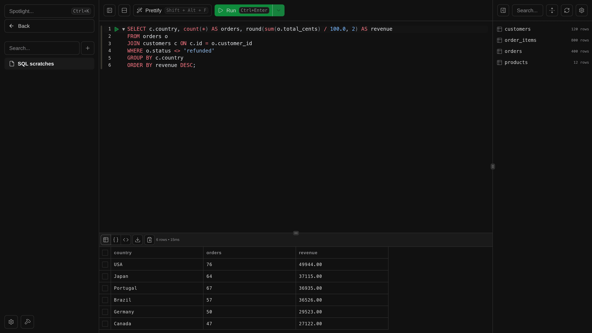
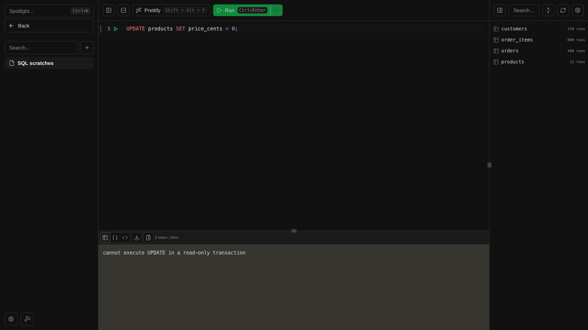

# typeorm-studio

**Browse your TypeORM database in Drizzle Studio with one command, with no config and no schema to write.**

Status: not published to npm yet, so the `npx` commands below will not work until it is.

```sh
npx typeorm-studio
```

Run it from your project and it finds your DataSource and `.env`, checks the database, and opens
[Drizzle Studio](https://orm.drizzle.team/drizzle-studio/overview). It starts read-only, so you
can look around without worrying about changing data by accident.



> **Unofficial and vibe-coded.** typeorm-studio is an AI-assisted adapter, built for NestJS apps.
> It runs the official, unmodified drizzle-kit, and the UI in these screenshots is Drizzle's hosted
> Studio at `https://local.drizzle.studio`. Not affiliated with or endorsed by the Drizzle Team or
> TypeORM.

## Features

- **Zero config.** It reuses the DataSource file your `typeorm -d <file>` scripts already point at.
- **Works with real projects.** TypeScript and JavaScript, ESM and CommonJS, NestJS layouts and
  monorepos.
- **Read-only by default.** Pass `--write` when you do want to edit.
- **Your credentials stay yours.** They are hidden from the output and never written to disk.
- **Clear failures.** If something is wrong, you get the reason and a hint for what to do next.



Run SQL against your data in the same place:



## Requirements

- Node.js 22.15 or newer
- PostgreSQL (the only supported database for now)
- A TypeORM project with its dependencies installed; TypeORM 0.3 and 1.x are tested
- Internet access, because the Studio UI is a hosted page

## Usage

```sh
npx typeorm-studio            # from your project or monorepo root
npx typeorm-studio --write    # allow edits
npx typeorm-studio --dry-run  # find the DataSource, env and database, then stop
```

| Option                    | What it does                                                         |
| ------------------------- | -------------------------------------------------------------------- |
| `[project-dir]`           | Project to open, instead of the current folder                       |
| `-d, --datasource <file>` | DataSource file to use instead of discovery                          |
| `--env-file <file>`       | Env file to load; repeatable, later wins; turns off `.env` discovery |
| `-p, --port <number>`     | Studio port (default 4983, or a free port if that one is taken)      |
| `--write`                 | Allow edits                                                          |
| `--dry-run`               | Find the project, load it and check the database, then stop          |
| `--no-open`               | Print the Studio link without opening the browser                    |
| `--verbose`               | Print timings and warnings                                           |
| `-h, --help`              | Show the help                                                        |
| `-v, --version`           | Show the version                                                     |

## How it works

1. **Find the DataSource.** It looks for a `package.json` script that runs `typeorm ... -d <file>`,
   then for a `data-source`, `ormconfig` or `typeorm.config` file that mentions `DataSource`. In a
   monorepo it searches the workspace packages too. If several match, it asks you to pick one with
   `-d`.
2. **Load your env.** `.env` files are loaded without overriding your shell.
3. **Read the connection.** Your DataSource file is imported in a separate process to get its
   connection options. This runs your file's code, including anything it imports.
4. **Check the database.** It connects once, so a wrong host or password fails with a useful
   message before Studio starts.
5. **Start Studio.** It runs the pinned drizzle-kit on `127.0.0.1` and opens the link.

## Safety

**Read-only mode is a guard against accidents, not a security boundary.** Connections start with
PostgreSQL's `default_transaction_read_only=on`, so normal writes fail:



That is only a session default, so a SQL statement can turn it off: running
`SET default_transaction_read_only = off` in the SQL console allows writes again. To really protect
a database, connect with a PostgreSQL user that has read-only grants.

**Only Studio can talk to the local server.** drizzle-kit answers requests from any origin, so
without protection any web page you visit could run SQL on your database. typeorm-studio binds to
`127.0.0.1` and rejects requests that do not come from `https://local.drizzle.studio`.

## What leaves your machine

Drizzle Studio's UI is a hosted web page. In our checks it sent a page view and an `init` event
(dialect, driver, UI settings) to its analytics, loaded Cloudflare's analytics script and sent one
Sentry request at load. Queries and rows go from your browser to the local server only, but this
is not a guarantee: the hosted page is closed source and can change at any time.

## Troubleshooting

| What you see             | What to do                                                                              |
| ------------------------ | --------------------------------------------------------------------------------------- |
| No DataSource file found | Point at it: `npx typeorm-studio -d src/data-source.ts`                                 |
| Several DataSource files | Pick one with `-d <file>`                                                               |
| Env validation failed    | Set the variables in `.env`, pass `--env-file <file>`, or export them in your shell     |
| Startup options rejected | Your pooler refuses read-only mode's startup options; connect directly or use `--write` |
| Port already in use      | Use another one with `--port <number>`, or omit `--port` to get a free one              |

## License

[MIT](LICENSE)
